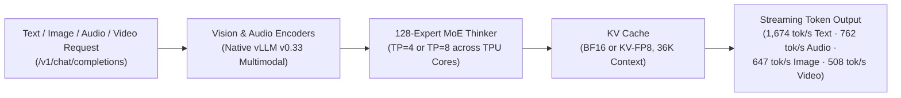

# Omni & Multimodal Serving on Google Cloud TPUs (TorchTPU)

PyTorch (`torch_tpu`) serving benchmarks for omni-modal models on **Google Cloud TPU v7x** and **TPU v5p**, evaluated across **`vllm-torchtpu` (`v0.33.0` & `v0.32.0`)** and **`sglang-torchtpu`**. On **`vllm-torchtpu v0.33.0`**, **Qwen3-Omni-30B-A3B** serves all four input modalities on **2 TPU v7x chips (`TP=4`)**: text (**`1,620.9 tok/s`** at `c=64`), image (**`647.3 tok/s`** at `c=16`), native **audio** (**`761.7 tok/s`** on `15s` WAV at `c=8`, **`24.2 ms` TTFT** at `c=1`), and native **video** (**`376.3 tok/s`** MP4 / **`507.7 tok/s`** 8-frame sequence at `c=8`), while `TP=8` reaches **`1,674.2 tok/s`** (`c=64`) and **`199.0 tok/s` (`4.90 ms` TPOT)** at `c=1` — **`1.34×–1.44×` faster than 4-chip TPU v5p**.

---

## Models & Licenses

This repository tracks omni-modal and multimodal model serving benchmarks on Google Cloud TPUs. Each model's folder contains detailed tables and reproduction commands.

| Model | Params & Precision | Architecture & Modalities | License | Folder |
| :--- | :---: | :--- | :---: | :--- |
| [`Qwen/Qwen3-Omni-30B-A3B-Instruct`](https://huggingface.co/Qwen/Qwen3-Omni-30B-A3B-Instruct) | 30B / 3B active MoE (`bf16`, `KV-FP8`) | 128-expert Thinker-Talker omni-modal model (text + image + audio + video, `36K` ctx) | Apache-2.0 | [`qwen3-omni-30b-a3b/`](qwen3-omni-30b-a3b/README.md) |
| [`Qwen/Qwen3-Omni-30B-A3B-Thinking`](https://huggingface.co/Qwen/Qwen3-Omni-30B-A3B-Thinking) | 30B / 3B active MoE (`bf16`, `KV-FP8`) | Chain-of-thought reasoning variant of Qwen3-Omni-30B-A3B | Apache-2.0 | [`qwen3-omni-30b-a3b/`](qwen3-omni-30b-a3b/README.md) |
| [`inclusionAI/Ming-flash-omni-2.0`](https://huggingface.co/inclusionAI/Ming-flash-omni-2.0) | 100B / 6.1B active MoE (`bf16`) | Unified omni-modal MoE (`vllm-omni` native `deploy/ming_flash_omni.yaml`) | MIT | [`ming-flash-omni-2.0/`](ming-flash-omni-2.0/README.md) |

---

## Hardware & Software Stack

| Component | Configuration |
| :--- | :--- |
| **TPU v7x** | 2 chips (`TP=4`, 4 TensorCores) and 4 chips (`TP=8`, 8 TensorCores), 96 GB HBM per TensorCore |
| **TPU v5p** | 4 chips (`TP=4`, 95 GB HBM/chip); horizontal multi-replica scaling verified across 8×4-chip replicas (`v5p-32`) |
| **Engine 1: vLLM** | `vllm-torchtpu v0.33.0` + `vllm-omni 0.33.0rc1` (native text/image/audio/video) and `vllm-torchtpu v0.32.0` |
| **Engine 2: SGLang** | `sglang-torchtpu` (`v0.2.0` eager & `main` compiled) |
| **Runtime** | PyTorch `2.13.0` + `torch_tpu 0.2.0` + `libtpu 0.0.50` |

---

## Serving Architecture



---

## Main Results (`Qwen3-Omni-30B-A3B`)

### 1. Text & Image Multimodal Serving (`36K` Context)

| Variant & Engine | Hardware (`TP`) | `text 1k` (`c=1` / peak `c=32–64`) | `text 8k/512` (`c=16`) | `mm_img 512×512` (`c=4` / `c=16`) | Comparison |
| :--- | :---: | :---: | :---: | :---: | :--- |
| **`Instruct` — `vllm v0.33.0` (`BF16`)** | **TPU v7x (`2` chips, `TP=4`)** | 170.2 / **1,620.9 tok/s** (`c=64`) | 1,002.6 tok/s | **393.1** (`TTFT 55.3 ms`) / **647.3 tok/s** | **1.26×** text (`c=64`) and **1.34×** multimodal vs. 4-chip TPU v5p (`2.5×–2.7×` per chip) |
| **`Instruct` — `vllm v0.32.0` (`BF16`)** | **TPU v7x (`4` chips, `TP=8`)** | 188.1 / **1,674.2 tok/s** (`c=64`) | — | *Upgrade to v0.33* | Peak aggregate throughput (+3.3% vs. `TP=4`) |
| **`Instruct` — `vllm v0.32.0` (`KV-FP8`)** | **TPU v7x (`4` chips, `TP=8`)** | **195.8** (`TPOT 4.86 ms`) / **1,673.8 tok/s** | 1,002.2 tok/s | *Upgrade to v0.33* | Lowest `c=1` decode latency (`34.8 ms` TTFT) |
| **`Thinking` — `vllm v0.32.0` (`BF16`)** | **TPU v7x (`4` chips, `TP=8`)** | **199.0** (`TPOT 4.90 ms`) / **1,595.5 tok/s** (`c=32`) | **1,107.4 tok/s** | — | **1.30×** (`c=32`) and **1.44×** (`8k/512`) vs. 4-chip TPU v5p |
| **`Instruct` — `vllm v0.33.0` (`BF16`)** | TPU v5p (`4` chips, `TP=4`) | 128.4 / **1,290.6 tok/s** (`c=64`) | 738.5 tok/s | 306.6 / **482.3 tok/s** | TPU v5p `v0.33.0` baseline (native multimodal) |
| **`Thinking` — `vllm v0.32.0` (`BF16`)** | TPU v5p (`4` chips, `TP=4`) | 141.6 / **1,229.7 tok/s** (`c=32`) | 766.8 tok/s | — | Scales linearly across 8 replicas on `v5p-32` (`~9,838 tok/s` aggregate) |
| `Instruct` — `sglang v0.2.0` (eager) | TPU v5p (`4` chips, `TP=4`) | 4.1 / 146.5 tok/s (`c=32`) | 53.6 tok/s | 15.1 / 64.1 tok/s | Uncompiled eager baseline (`8.8×` slower than compiled `vllm-torchtpu`) |

### 2. Native Audio & Video Input Serving (`vllm-torchtpu v0.33.0`, 2 TPU v7x Chips, `TP=4`)

| Input Modality & Payload | Avg Prompt Tokens | `c=1` Output Speed & TTFT | `c=4` Output Speed & TTFT | **`c=8` Peak Output Speed** | Notes |
| :--- | :---: | :---: | :---: | :---: | :--- |
| **Audio (`5s` 16 kHz WAV)** | 90 | **201.0 tok/s** (`24.2 ms`) | 332.1 tok/s (`48.8 ms`) | **634.0 tok/s** (`145.9 ms`) | `audio_url` base64 WAV (`517.6 tok/s` at `c=16`) |
| **Audio (`15s` 16 kHz WAV)** | 220 | **203.9 tok/s** (`25.2 ms`) | 287.0 tok/s (`562.3 ms`) | **761.7 tok/s** (`65.2 ms`) | Native 15-second acoustic clip understanding |
| **Video (`8` frames, `448×448` MP4)** | 416 | **189.4 tok/s** (`58.7 ms`) | 205.1 tok/s (`83.4 ms`) | **376.3 tok/s** (`1,189 ms`) | Native H.264 MP4 via `video_url` |
| **Video (`8` frames, `448×448` frames)** | 1,607 | **198.5 tok/s** (`41.9 ms`) | 303.7 tok/s (`66.8 ms`) | **507.7 tok/s** (`96.0 ms`) | 8-frame `image_url` sequence (`3.9×` more visual tokens) |

---

## Key Engineering Takeaways

1. **`vllm-torchtpu v0.33.0` unlocks all four input modalities for `Qwen3-Omni-30B-A3B` on 2 TPU v7x chips (`TP=4`):** Native text (`1,620.9 tok/s`), audio (`761.7 tok/s`, `24–25 ms` `c=1` TTFT), image (`647.3 tok/s`), and video (`376.3–507.7 tok/s`) all run cleanly on a single `TP=4` deployment. Note: combining `audio_url` + `image_url` in the *same* prompt currently hits an upstream DeepStack tensor-width mismatch (`2048` vs. `8192`, documented in [`APPENDIX.md`](APPENDIX.md)).
2. **`KV-FP8` helps `c=1` latency on TPU v7x and `32K` context on TPU v5p:** On TPU v7x `TP=8`, `KV-FP8` reduces `c=1` TTFT to `34.8 ms` (`195.8 tok/s`) with no loss at `c=64`. On TPU v5p `TP=4`, `KV-FP8` boosts `32k/256 c=4` throughput (`204.2–220.8 tok/s` vs. `135.6 tok/s` `BF16`).
3. **`sglang-torchtpu` & `Ming-flash-omni-2.0` diagnostics:** Compiled `Qwen3-Omni` on `sglang-torchtpu` (`main`) currently hits an upstream `AttributeError` (`capture_aux_hidden_states`), and `Ming-flash-omni-2.0` hits a `rope_scaling_factor = None` `TypeError` in `sglang` while loading natively on `vllm-omni 0.33.0rc1` (`deploy/ming_flash_omni.yaml`). Full details are in [`APPENDIX.md`](APPENDIX.md) and [`ming-flash-omni-2.0/`](ming-flash-omni-2.0/README.md).

---

## How to Reproduce

```bash
# Serve Qwen3-Omni-30B-A3B-Instruct on 2 TPU v7x chips (TP=4) with vllm-torchtpu v0.33.0
vllm serve /path/to/Qwen/Qwen3-Omni-30B-A3B-Instruct \
  --served-model-name Qwen/Qwen3-Omni-30B-A3B-Instruct \
  --host 0.0.0.0 --port 8000 \
  --tensor-parallel-size 4 --max-model-len 16384 \
  --limit-mm-per-prompt '{"image": 16, "audio": 2, "video": 2}' \
  --trust-remote-code

# Text throughput benchmark (c=64)
python3 scripts/benchmark_omni_serving.py \
  --model Qwen/Qwen3-Omni-30B-A3B-Instruct \
  --input-tokens 1024 --output-tokens 256 --concurrency 64 --num-requests 64

# Multimodal image-text benchmark (c=16)
python3 scripts/benchmark_omni_serving.py \
  --model Qwen/Qwen3-Omni-30B-A3B-Instruct \
  --input-tokens 512 --output-tokens 256 --concurrency 16 --num-requests 16 --multimodal
```

---

## Deep Dives, Logs & Raw Results

- **Model Guides:** [`qwen3-omni-30b-a3b/`](qwen3-omni-30b-a3b/README.md) · [`ming-flash-omni-2.0/`](ming-flash-omni-2.0/README.md)
- **Ablations & Upstream Diagnostics:** [`APPENDIX.md`](APPENDIX.md)
- **Engineering Log:** [`WORKING_LOG.md`](WORKING_LOG.md)
- **Verified JSON Metrics:** [`results/omni_multimodal_summary.json`](results/omni_multimodal_summary.json) · [`results/qwen3_omni_audio_video_v7x.json`](results/qwen3_omni_audio_video_v7x.json)
